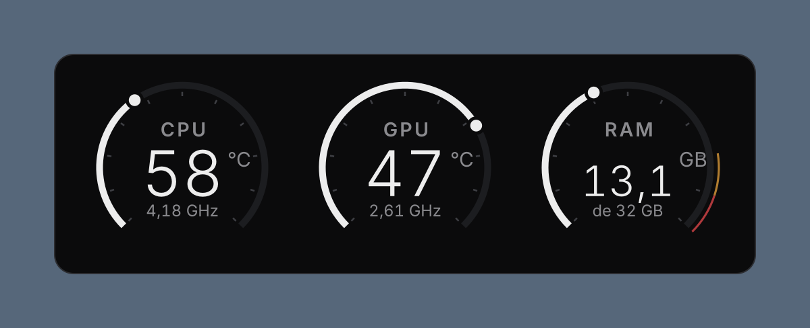

# Manômetros

Painel no estilo dos manômetros de carro para Linux. Pode ficar como uma
janelinha num canto do monitor, como uma faixa na parte de baixo ou ocupando
um monitor inteiro.

| Mostrador | O arco mostra | O número do meio mostra | Embaixo, pequeno |
|---|---|---|---|
| **CPU** | uso (%) | temperatura (°C) | clock (GHz) |
| **GPU** (NVIDIA) | uso (%) | temperatura (°C) | clock (GHz) |
| **RAM** | % em uso | GB usados | total de RAM |

A cor muda para âmbar e depois vermelho quando a temperatura (CPU/GPU) ou a
% de RAM passa dos limites do config.



Feito para o **Pop!_OS 24.04 com COSMIC (Wayland)**. Também deve funcionar em
outros sistemas baseados no Ubuntu 24.04 e em compositores Wayland com
layer-shell (Sway, Hyprland, KDE). Gasta pouco: quase nada de CPU sem
animação, cerca de 1 a 2% de um núcleo com animação, e uns 100 MB de RAM.

---

## Instalação

Abra o terminal e rode, **sem sudo**:

```bash
git clone https://github.com/pauloestefani/manometros.git
cd manometros
./instalar.sh
```

Sem o git, clique em **Code → Download ZIP** nesta página, extraia e rode
`bash instalar.sh` dentro da pasta.

O instalador faz 5 passos e pergunta antes de cada um que muda algo:

| Passo | O que faz | Precisa de senha? |
|---|---|---|
| 1 | Confere as bibliotecas. Se faltar alguma, mostra o comando `sudo apt install …` e **pergunta antes de rodar** | Só se faltar algo |
| 2 | Copia o programa para `~/.local/share/manometros` e cria o comando `manometros` | Não |
| 3 | Escolhe o modo: janelinha, faixa ou monitor inteiro | Não |
| 4 | Ativa o início automático com a sessão | Não |
| 5 | Mostra um diagnóstico e abre o painel | Não |

Os pacotes do passo 1 são todos oficiais do Ubuntu/Pop!_OS: `python3-gi`,
`python3-gi-cairo`, `gir1.2-gtk-3.0`, `gir1.2-gtklayershell-0.1` e `fonts-inter`.

Se o terminal disser que `manometros` não existe, saia da sessão e entre de
novo. Até lá, use `~/.local/bin/manometros`.

## Usando

**Clique no painel** para abrir o menu:

- **Monitor**: em qual monitor ele aparece. "Automático" escolhe o que não é ultrawide.
- **Posição**: o canto da janelinha.
- **Tamanho**: de minúsculo (242 × 72 pixels) a muito grande. Nos dois menores,
  o arranjo muda para caber tudo legível: sem marquinhas no arco, temperatura como "58°",
  RAM só com o número (o "de 32 GB" logo abaixo diz a unidade) e clock com uma casa decimal.
- **Ficar por cima das janelas**: desligado, a janelinha fica atrás das janelas abertas.
- **Modo**: janelinha, faixa ou monitor inteiro.
- **Verificar atualizações** / **Atualizar para a versão X**
- **Abrir configuração**
- **Fechar o painel**

As escolhas ficam salvas em `~/.config/manometros/config.toml`.

Pelo terminal:

```bash
manometros --listar       # monitores e sensores (temperatura, uso e clock)
manometros --reiniciar    # reabre o painel (depois de editar a configuração à mão)
manometros --parar        # fecha o painel
manometros --atualizar    # procura e instala uma versão nova
manometros --janela --demo   # janela comum com dados de exemplo, para ver o visual
```

## Atualizações

O painel puxa a versão mais nova direto do git, deste repositório no GitHub:

- **Automático:** uma vez por dia, ele compara o número de versão do ramo
  principal (`manometros/__init__.py`) com o instalado. Se houver versão nova,
  aparece um **ponto âmbar** no canto do painel.
- **Na hora:** clique no painel e escolha **Verificar atualizações**. Se houver
  versão nova, o item vira **Atualizar para a versão X**, que mostra o que mudou.

Quando você confirma, o painel faz o seguinte:

1. Baixa o código do GitHub.
2. Confere se a versão dentro do pacote é a anunciada e se o código compila.
3. Troca a pasta do programa e reinicia sozinho.

Não precisa de senha. Se algo der errado, a versão anterior continua instalada.
No terminal, o mesmo vale com `manometros --atualizar`. Para desligar a verificação
automática, use `verificar = false` em `[atualizacao]` no config.

### Publicando uma versão nova

1. Faça as mudanças.
2. Aumente o número em `manometros/__init__.py` (por exemplo, de `0.2.0` para `0.2.1`).
3. Envie para o ramo principal com `git push`.

Todos os painéis instalados veem a versão nova na próxima verificação. A mensagem
do último commit aparece como "novidades" na janela de atualização. Criar uma
*release* no GitHub é opcional: se existir uma com número maior, ela também é considerada.

## Configuração

Arquivo: `~/.config/manometros/config.toml`. Ele é comentado em português.
Depois de editar à mão, rode `manometros --reiniciar`.

- `layout`: "janela", "faixa" ou "inteiro"
- `monitor`: "auto", o número do `--listar` ou parte do nome do modelo
- `canto`, `margem`, `escala`, `camada`: posição, distância da borda, tamanho e
  se fica acima ou abaixo das janelas (modo janela)
- `cor_destaque`: a cor dos arcos no estado normal
- `[cpu]`, `[gpu]`: temperatura (°C) em que fica âmbar (`alerta`) e vermelho (`critico`)
- `[cpu] clock`: "maximo" (o núcleo mais rápido no momento) ou "media" (média de todos)
- `[ram]`: % em uso em que fica âmbar e vermelho

## Como ele se fixa no monitor (Wayland)

No Wayland, um programa comum não escolhe em qual monitor abre. O Manômetros usa o
recurso **layer-shell**, o mesmo de painéis e docks, que permite escolher o monitor
e o canto. Se o monitor escolhido for desligado, o painel some e volta sozinho
quando o monitor reaparece.

## Problemas comuns

- **O painel não aparece.** Rode `manometros --listar`. Confira:
  - `layer-shell: sim`
  - qual monitor tem a marca `<- painel`

  Veja também o registro em `~/.cache/manometros/manometros.log`.
- **O menu não abre ao clicar.** Use o `config.toml` (ou `manometros --monitor N`)
  e me conte em uma *issue*.
- **A fonte ficou diferente.** Instale a Inter: `sudo apt install fonts-inter`.
- **GPU não encontrada.** Confira se o driver NVIDIA está ativo, com `nvidia-smi`.

## Desinstalar

```bash
./desinstalar.sh
```

Remove o programa, o comando e o início automático. Pergunta se deve apagar a
configuração.

> Versões até a 0.2.0 também mostravam o uso do Claude Code e podiam configurar a
> statusline dele. Se você configurou, ela continua funcionando; o `desinstalar.sh`
> devolve a statusline que você tinha antes.
